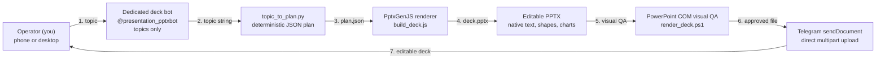

# Architecture

How a brief in Telegram becomes an editable deck delivered back into the same chat. GitHub renders the Mermaid diagram below natively.

## Flow

In one sentence: a topic goes to the dedicated deck-only Telegram bot, which deterministically converts it into a structured slide plan, renders the plan locally with PptxGenJS into editable PowerPoint elements, visually checks the rendered slides, and sends the finished `.pptx` back into the same chat. Canva is not in this path.

## Components

| Component | Role | Runs where | Notes |
|-----------|------|-----------|-------|
| **Operator** | Sends a topic and opens the delivered file. | Phone or desktop | Generic topics only; no personal data. |
| **Dedicated deck bot** | `@presentation_pptxbot`; accepts only topics, rejects everything else with one fixed line. | Hermes `deckbot` profile + Telegram polling | Separate from the operator chat so model/tool drift cannot break delivery. |
| **Topic planner** | `scripts/topic_to_plan.py` — turns any topic into a structured JSON plan. | Local Python | Deterministic, offline, no model/network, no invented facts. |
| **PptxGenJS renderer** | `pptxgen/scripts/build_deck.js` — turns the plan into an editable 16:9 PPTX. | Local Node | Native text, shapes and charts. Not a screenshot. |
| **Visual QA** | `pptxgen/scripts/render_deck.ps1` — exports every slide to PNG for inspection. | Local PowerPoint COM | LibreOffice is not installed; this is the verified substitute. |
| **Telegram sender** | Direct multipart `sendDocument`, with a known-IP fallback that rewinds the file handle. | Local Python | Keeps credentials out of the repo. |
| **Legacy fallback** | `scripts/deck_from_text.py` — older deterministic `python-pptx` builder. | Local Python | Used only if the PptxGenJS step fails. |
| **Deck skill** | `skills/beautiful-deck/SKILL.md` — design rules for operator-side research decks. | Hermes operator/deckbot profiles | See [design contract](design_contract.md). |

## Decision points

- **Tool selection:** PptxGenJS is the primary and only generation path for the Telegram bot. Canva MCP is not called; the older python-pptx engine is a safety fallback only.
- **Model selection:** the driving LLM is chosen independently in the operator chat via `/model` tier aliases. The deck bot makes no model call — see [model switching](model_switching.md).
- **Failure policy:** every path must deliver a working file. If planning or rendering fails, the bot falls back to the legacy builder; delivery is retried once with rewound file handles; the Telegram turn never fails silently.

## Why Canva was removed

Canva MCP was exercised earlier in the project, but both known accounts became unusable for generation (one out of credit, one with design generation disabled at team level). Requiring Canva put a paid/third-party account on the critical path and conflicted with the project brief. The local PptxGenJS path is free, editable, deterministic and fully under our control.
