# Architecture

How a brief in Telegram becomes an editable deck delivered back into the same chat. GitHub renders the Mermaid diagram below natively.

## Flow

```mermaid
flowchart LR
    U["Operator (you)<br/>phone or desktop"]
    B["Dedicated deck bot<br/>@presentation_pptxbot<br/>topics only"]
    P["llm_topic_to_plan.py<br/>model-written content + safe schema"]
    S["topic_to_plan.py<br/>deterministic fallback"]
    R["PptxGenJS renderer<br/>build_deck.js"]
    Q["PowerPoint COM visual QA<br/>render_deck.ps1"]
    F["Editable PPTX<br/>native text, shapes, charts"]
    D["Telegram sendDocument<br/>direct multipart upload"]

    U -->|"1. topic"| B
    B -->|"2a. topic string"| P
    P -->|"fallback only"| S
    P -->|"3. plan.json"| R
    S -->|"3. plan.json"| R
    R -->|"4. deck.pptx"| F
    F -->|"5. visual QA"| Q
    Q -->|"6. approved file"| D
    D -->|"7. editable deck"| U
```

In one sentence: a topic goes to the dedicated deck-only Telegram bot, which asks a model planner for topic-specific slide content in the user's language, falls back to a deterministic planner if needed, renders the plan locally with PptxGenJS into editable PowerPoint elements, visually checks the rendered slides, and sends the finished `.pptx` back into the same chat. Canva is not in this path.

## Components

| Component | Role | Runs where | Notes |
|-----------|------|-----------|-------|
| **Operator** | Sends a topic and opens the delivered file. | Phone or desktop | Generic topics only; no personal data. |
| **Dedicated deck bot** | `@presentation_pptxbot`; accepts only topics, rejects everything else with one fixed line. | Hermes `deckbot` profile + Telegram polling | Separate from the operator chat so model/tool drift cannot break delivery. |
| **Model planner** | `scripts/llm_topic_to_plan.py` — Hermes one-shot call writes topic-specific content in the user's language and merges it into the safe 7-layout schema. | Local Python + Hermes CLI | Default tier `free`; override with `DECK_PLAN_MODEL`. No external facts are added. |
| **Deterministic planner** | `scripts/topic_to_plan.py` — turns any topic into a structured JSON plan. | Local Python | Offline safety fallback when the model planner fails. |
| **PptxGenJS renderer** | `pptxgen/scripts/build_deck.js` — turns the plan into an editable 16:9 PPTX. | Local Node | Native text, shapes and charts. Not a screenshot. |
| **Visual QA** | `pptxgen/scripts/render_deck.ps1` — exports every slide to PNG for inspection. | Local PowerPoint COM | LibreOffice is not installed; this is the verified substitute. |
| **Telegram sender** | Direct multipart `sendDocument`, with a known-IP fallback that rewinds the file handle. | Local Python | Keeps credentials out of the repo. |
| **Legacy fallback** | `scripts/deck_from_text.py` — older deterministic `python-pptx` builder. | Local Python | Used only if the PptxGenJS step fails. |
| **Deck skill** | `skills/beautiful-deck/SKILL.md` — design rules for operator-side research decks. | Hermes operator/deckbot profiles | See [design contract](design_contract.md). |

## Decision points

- **Tool selection:** PptxGenJS is the primary and only generation path for the Telegram bot. Canva MCP is not called; the older python-pptx engine is a safety fallback only.
- **Model selection:** the planner tier is chosen in the operator chat via `/model` tier aliases, then read by the bot through `DECK_PLAN_MODEL` (default `free`). The bot cannot chat or change its own config — see [model switching](model_switching.md).
- **Failure policy:** every path must deliver a working file. If planning or rendering fails, the bot falls back to the legacy builder; delivery is retried once with rewound file handles; the Telegram turn never fails silently.

## Why Canva was removed

Canva MCP was exercised earlier in the project, but both known accounts became unusable for generation (one out of credit, one with design generation disabled at team level). Requiring Canva put a paid/third-party account on the critical path and conflicted with the project brief. The local PptxGenJS path is free, editable, deterministic and fully under our control.
