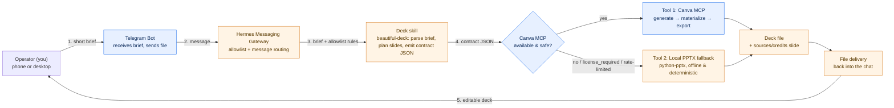

# Architecture

How a brief in Telegram becomes an editable deck delivered back into the same chat. GitHub renders the Mermaid diagram below natively.

## Flow

In one sentence: a brief goes from Telegram through the Hermes gateway to the deck skill, which emits a contract JSON and tries Canva MCP first; if Canva is unavailable, licensing-blocked, or rate-limited it falls back to the offline local PPTX engine, then the finished file — with a sources/credits slide — is handed back to the same chat.

## Components

| Component | Role | Runs where | Notes |
|-----------|------|-----------|-------|
| **Operator** | Sends the brief and opens the delivered file. | Phone or desktop | Use a generic brief; no personal data on screen. |
| **Telegram Bot** | Receives the brief; later sends the finished document back. | Telegram cloud | Private, allowlist-only. API reachability from this PC is currently a limitation. |
| **Hermes Messaging Gateway** | Authenticates/authorizes the user (allowlist), routes the message to the agent, and handles outbound file delivery. | Hermes runtime | Slash commands such as `/model` are handled here; credentials stay in Hermes config, never in repo code. |
| **Deck skill (`beautiful-deck`)** | Turns the brief into a slide plan and a strict contract JSON; enforces the design contract. | Hermes agent | The agent emits data only — it never writes rendering code. See [design contract](design_contract.md). |
| **Canva MCP connector (Tool 1)** | Generates design candidates, materializes a design, and exports an editable PPTX. | Remote (Canva MCP) | Free-plan constraints and rate limits apply; falls back on `license_required`. See [Canva MCP](canva_mcp.md). |
| **Local PPTX fallback (Tool 2)** | Renders the contract JSON into an editable 16:9 PPTX with a credits slide. | Local (`python-pptx`) | Offline, deterministic, no account or secrets. See [PPTX fallback](pptx_fallback.md). |
| **Deck file + credits** | The deliverable: editable `.pptx`; optional locally produced PDF on request. | Local / transferred | Final slide always lists sources/credits. See [image sourcing](image_sourcing.md). |
| **File delivery** | Sends the deck back into the originating Telegram chat as a document. | Hermes gateway → Telegram | Subject to the 50 MB Telegram file cap. |

## Decision points

- **Tool selection:** Canva MCP is preferred for bespoke design; the local engine is the guaranteed path when Canva cannot be used. Both paths produce the same deliverable shape, so the chat experience is identical.
- **Model selection:** the driving LLM is chosen independently of the pipeline, from Telegram via `/model` tier aliases. This does not change the deck engine — see [model switching](model_switching.md).
- **Failure policy:** every path must deliver a working file. Transient, idempotent failures are retried; licensing/format failures trigger a redesign or the local fallback; the Telegram turn never fails silently.
