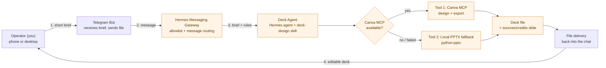

# Repo Blueprint — Beautiful Deck Agent

Working notes for building this repo. This file is the single source of truth for
structure, docs, the demo, and the honest-limitations section. Keep it short and
shippable — this is a one-week individual assignment.

> **Hard rule:** no API keys, bot tokens, Telegram user IDs, chat IDs, emails, or
> any other personal data in this repo. Use placeholders only (for example
> `<your-bot-token>`), and keep real values in your local `.env`, which is
> git-ignored. Check screenshots and logs for visible IDs before committing.

---

## 1. Folder layout

Keep it flat and obvious. Add files only when the demo needs them.

```text
presentation-agent/
├── README.md                  # the only doc a reviewer needs to read
├── LICENSE                    # MIT (already present)
├── .gitignore                 # ignores .env, output/, generated decks, images
├── .env.example               # placeholder keys only — safe to commit
├── .env                       # LOCAL ONLY — never commit (git-ignored)
│
├── docs/
│   └── repo_blueprint.md      # this file
│
├── scripts/
│   ├── telegram_smoke_test.py # existing: proves the Telegram bridge works
│   └── run_demo.py            # optional: one command to start the whole demo
│
├── agent/
│   ├── AGENTS.md              # agent role, rules, and allowed tools
│   └── skills/
│       └── deck-design/
│           └── SKILL.md       # the design pipeline the agent follows
│
├── src/
│   ├── telegram_bridge.py     # receives briefs, enforces allowlist, sends files
│   ├── deck_canva.py          # Tool 1: Canva MCP client
│   └── deck_pptx.py           # Tool 2: local python-pptx fallback
│
├── examples/
│   └── brief_example.md       # a sample brief for the demo (no personal data)
│
├── output/                    # generated decks — git-ignored, never committed
└── telegram_qr.png            # optional bot-invite placeholder image
```

**Notes**

- `telegram_qr.png` and any screenshots must not show real chat IDs, usernames,
  or personal messages. The root `.gitignore` already ignores `*.png`, so commit
  images only deliberately and after redaction.
- `output/`, `*.pptx`, and `*.pdf` are already git-ignored — generated decks stay
  local.
- Do not add a `requirements.txt` until there is a real dependency to pin; a
  short install line in the README is enough for a one-week project.

---

## 2. Minimal README outline

Aim for one screen of scrolling plus the diagram. Section order:

1. **Title + one-line pitch** — "Turn a text brief in Telegram into an editable
   presentation, delivered back in chat."
2. **Status** — one line: what works today vs. what is planned.
3. **The problem (why this exists)** — 2–3 bullets on the real problem fit:
   making a decent deck is slow, repetitive, and annoying on a phone; the agent
   does it from a single message.
4. **60-second demo** — what to type, what appears, one screenshot placeholder
   (redacted). Link to the full script in §4 of this file.
5. **How it works** — embed the Mermaid diagram from §3 (GitHub renders it), plus
   one sentence naming the two tools.
6. **Setup (short)** — copy `.env.example` → `.env`, fill in the token and your
   own numeric user ID locally, install, run the smoke test, start the gateway.
   Repeat: never commit `.env`.
7. **What I couldn't do / limitations** — a short, honest list; link to the
   template in §5.
8. **License** — MIT, link to `LICENSE`.

Avoid: long tutorials, roadmaps nobody will read, and copied README boilerplate.
Scoring rewards a working demo and honesty, not doc volume.

---

## 3. Architecture diagram

Paste this fenced block into the README under "How it works". GitHub renders
Mermaid natively.



Reading it in one sentence: a brief goes from Telegram through the Hermes gateway
to the agent, which tries Canva MCP first and falls back to a locally generated
PPTX, then hands the finished file back to the same chat.

---

## 4. Demo script outline (aim: 90 seconds)

Practice this once end-to-end before recording. Show one happy path and, if time
allows, the fallback — that proves both tools and real robustness.

| Time | Beat | What you say / do |
|------|------|-------------------|
| 0:00 | Hook | "I'll make a presentation from my phone by sending one message." |
| 0:08 | Send brief | Type a short, generic brief into the bot, e.g. *"5 slides introducing [topic] to [audience], clean and modern."* |
| 0:18 | Bridge | Point at the reply confirming the bot received it (the smoke-test "Pong" path if showing setup). |
| 0:28 | Agent at work | Screen-share the agent log: brief parsed, slides planned, tool chosen. |
| 0:40 | Tool use | Show the Canva MCP call producing the design (this is **Tool 1**). |
| 0:55 | Fallback (optional) | "If Canva isn't available, the agent falls back to a local PPTX" — show **Tool 2** generating an editable file with a sources/credits slide. |
| 1:10 | Delivery | The `.pptx` appears in the Telegram chat; tap to open it. |
| 1:20 | Proof | Flip through two slides and click into a text box to show it's editable. |
| 1:28 | Close | One honest limitation line: "It still can't [see §5] — that's next." |

**Demo hygiene**

- Use a made-up topic and audience; no real names, emails, IDs, or private chat
  content on screen.
- Redact the Telegram chat area if it shows a numeric ID or username.
- Keep a backup: if the live tool call is slow, have a pre-generated deck ready
  in `output/` (local only) so delivery still lands.

---

## 5. "What gave me a hard time / limitations" section template

Paste into the README near the end. Replace every `[...]` with one honest
sentence. Keep it specific and blame-free — reviewers reward honesty.

```markdown
## What gave me a hard time / limitations

### What I couldn't do
- `[Feature that is planned but not finished — e.g. automatic image sourcing.]`
- `[Tool or integration that was attempted but didn't work in time.]`
- `[Known quality limit — e.g. layout is template-based, not fully bespoke.]`

### What gave me a hard time
- `[One real technical obstacle and how I worked around it in one sentence.]`
- `[One setup/configuration headache (e.g. bot allowlist, MCP connection) and the fix.]`
- `[One design trade-off: what I chose to simplify to ship on time.]`

### What's next
- `[The single highest-value improvement if I had another week.]`
```

Guidance: write 2–3 bullets per subsection, not paragraphs. Name the limitation
plainly ("the agent cannot X yet"), then say what you did instead. Do not hide
failures — a short honest gap reads better than a vague "everything works".

---

## 6. Pre-commit safety checklist

Before every commit and before recording the demo:

- [ ] `git status` shows no `.env` file staged.
- [ ] No token, user ID, chat ID, email, or username in any tracked file or
      screenshot (search the repo for `@`, long digit strings, and `token`).
- [ ] Generated decks in `output/` are not staged.
- [ ] README embeds only placeholder values in setup steps.
- [ ] The Mermaid diagram renders correctly on GitHub (preview the README).
